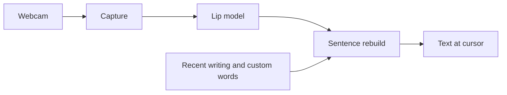

# Unsaid

**Type by mouthing words at your webcam, with no sound. Languages can mix inside one sentence.**

This repository contains the plan for the project. There is no code yet.

---

## Guide

1. 📖 **[Read the goal](PLAN.md#goal)**: what we want and what counts as better than what's public.
2. 🧪 **[See the first check](PLAN.md#first-check)**: how much of a sentence comes back from mouth shapes alone.
3. 🚀 **[Follow the steps](PLAN.md#steps)**: 10 steps, each with a pass check.
4. 🔧 **[See what's still open](PLAN.md#open-questions)**: what has to be decided before step 2.

## How it works



Hold a key, mouth the words, let go. The text shows up at the cursor in whatever app you're in.

### 1. Capture

Films only while the key is held. It keeps the whole face, not just the mouth, because tones show a little in the head and eyebrows.

**What it gets:** webcam frames.

**What it sends:** face and mouth crops.

### 2. Lip model

Reads sounds, not words. Sounds aren't tied to a language, so the model doesn't have to pick one and a sentence can switch language halfway.

**What it gets:** face and mouth crops.

**What it sends:** its top guesses for the sounds.

### 3. Sentence rebuild

Lips don't show everything, so an LLM picks the real sentence from the context.

**What it gets:** the sound guesses, your recent writing and your custom words.

**What it sends:** the final sentence.

### 4. Dictation app

The small program around all this. It reads the key and puts the text at the cursor.

**What it gets:** the final sentence.

**What it sends:** text into the app you're using.

> [!IMPORTANT]
> Nothing is built yet, and none of this has been tested on real video. Lips alone can't match voice dictation: p, b and m look the same and tones barely show. The goal is better text for one person's real dictation, not a new record on lip-reading benchmarks.

## Repository structure

```
unsaid/
├── README.md    project overview
└── PLAN.md      goal, numbers, steps and open questions
```

## Documentation

### Plan

- **[Goal](PLAN.md#goal)**: what we build and what better means.
- **[Steps](PLAN.md#steps)**: the 10 steps and their pass checks.
- **[Open questions](PLAN.md#open-questions)**: decisions still needed.

### Numbers

- **[Where public models are today](PLAN.md#where-public-models-are-today)**: the scores to compare with.
- **[Why lips aren't enough](PLAN.md#why-lips-arent-enough)**: how many words look the same.
- **[First check](PLAN.md#first-check)**: rebuilding sentences from mouth shapes.

### Data

- **[Public data](PLAN.md#public-data)**: datasets per language.
- **[Simulated mouths](PLAN.md#simulated-mouths)**: what simulation can and can't add.

## Support and resources

- [Lipflow](https://github.com/amywork777/lipflow): closest public tool and the one to beat.
- [MultiVSR](https://github.com/Sindhu-Hegde/multivsr): 13-language lip-reading model and dataset.
- [ViCocktail](https://huggingface.co/datasets/nguyenvulebinh/ViCocktail): Vietnamese audio-visual dataset.
- [WikiPron](https://github.com/CUNY-CL/wikipron): pronunciation lists.

## License

No license yet.

Public models and datasets have their own terms and some are non-commercial, so the project stays personal use until that is checked.
